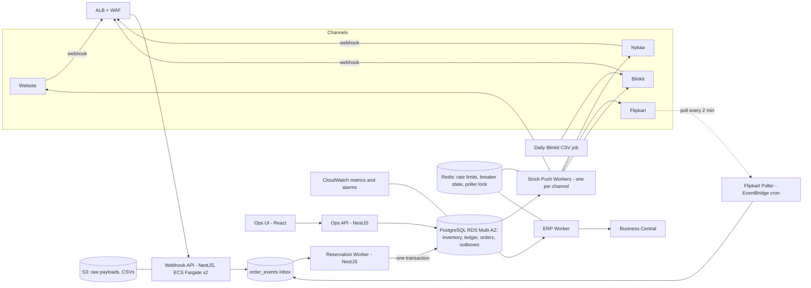

# Order & Inventory Sync Service: Design

**What this does:** takes orders from all 4 channels into one place, reserves stock safely, keeps each channel's stock fresh (within 60 seconds), and sends every confirmed order to Business Central (BC) exactly once.

**Main idea in one line:** the database makes sure we never sell more than we have, and a small safety buffer makes sure marketplaces don't show stale stock and cause cancellations.

## 1. Architecture



**What runs where:** one NestJS codebase, deployed as three small services on ECS Fargate:
- `api`: receives webhooks and serves the ops screen.
- `worker`: reserves stock, pushes stock to channels, sends orders to ERP. Each channel gets its own worker pool, so one channel failing doesn't affect the others.
- `scheduler`: EventBridge triggers Flipkart polling and the daily Blinkit CSV.

PostgreSQL (RDS, Multi-AZ) is the single source of truth. Redis only holds temporary things (rate-limit counters, circuit-breaker state, a poller lock), so losing Redis loses nothing important. S3 keeps raw payloads and CSVs. Secrets Manager keeps channel credentials.

**Rough monthly cost:** RDS ~₹20k, Fargate ~₹8k, Redis ~₹3k, ALB/WAF ~₹4k, S3/CloudWatch/Secrets ~₹4k, so about **₹40k**. No Kafka or other extra services.

## 2. Data model

| Table | Key columns / rules |
|---|---|
| `inventory` | `sku (PK), on_hand, reserved, safety_buffer, version`. Check: `reserved >= 0 AND reserved <= on_hand` |
| `inventory_ledger` (append-only) | `id, sku, delta_on_hand, delta_reserved, reason (RESERVE/RELEASE/DISPATCH/RETURN/ADJUST), order_id, actor, created_at`. Never updated or deleted |
| `orders` | `id, channel, external_order_id, status, state_rank, total`. **`UNIQUE(channel, external_order_id)`** |
| `order_items` | `order_id, sku, qty, unit_price` |
| `order_events` (inbox) | `id, channel, event_key, raw_payload_ref, received_at, processed_at`. **`UNIQUE(channel, event_key)`** (event_key = channel's event id, or a hash of the payload) |
| `channel_stock` | `sku, channel, published_qty, desired_qty`, PK `(sku, channel)` |
| `stock_outbox` | `sku, channel, desired_qty, status, attempts, next_attempt_at`. A partial unique index on pending `(sku, channel)` so repeated changes merge into one |
| `erp_outbox` | `order_id UNIQUE, idempotency_key UNIQUE, status, attempts, next_attempt_at, last_error` |
| `dead_letters`, `sync_attempts` | messages that kept failing (with payload and error); a log of every external call |

**Avoiding duplicate orders:** two checks. The inbox rejects a repeated event, and the `orders` table rejects a repeated order. Both use `INSERT ... ON CONFLICT DO NOTHING`, so even two identical webhooks arriving at the same time are safe.

## 3. Order ingestion

- **Webhooks (Website, Nykaa, Blinkit):** check the signature, save the raw event to the inbox (and S3), reply 200 right away. No heavy work happens in the request, so a slow ERP never blocks a webhook.
- **Flipkart polling:** every 2 minutes, remembering where we stopped (a watermark). Each poll re-reads the last 5 minutes so a crash can't leave a gap. The repeats are dropped by the unique keys. A Redis lock makes sure only one poller runs.
- **Out-of-order events:** every order has a state with a rank: `CREATED < CANCELLED < RETURNED`. An event is applied only if it moves the order *forward*. If a cancel arrives before its create, we keep it aside, and when the create arrives the order is saved directly as `CANCELLED` without reserving any stock. If nothing matches after 30 minutes, it goes to the ops screen.
- **A channel is down:** each channel has its own workers and circuit breaker, so others keep running. Channels that send webhooks will retry, and our inbox ignores repeats. Flipkart simply continues from its watermark. A daily job also re-checks the last 24 hours with each channel (where an API exists) to catch anything missed.

## 4. Inventory consistency: two channels, last unit

**Bad way:** read the stock, check it is above 0, then subtract. Two orders can both read "1", both pass the check, and we oversell.

**Good way:** do the check and the subtract in *one single statement*. Postgres locks the row, so the two orders go one after the other.

```text
reserve(order):
  TX1: INSERT orders(RECEIVED) ON CONFLICT(channel, external_order_id) DO NOTHING
       if it already existed: only apply the update if it moves state forward; stop

  TX2 (all items or none):
       for sku in sorted(items):                  # same order every time -> no deadlocks
         rows = UPDATE inventory
                SET reserved = reserved + :qty, version = version + 1
                WHERE sku = :sku AND on_hand - reserved >= :qty   # check + subtract together
         if rows == 0: ROLLBACK TX2 and go to REJECT
         INSERT inventory_ledger(RESERVE, ...)
       UPDATE orders SET status = CONFIRMED
       INSERT erp_outbox(order_id, key)            # same transaction -> order can't get lost
       save stock_outbox row for each sku x channel
       COMMIT

  REJECT (TX3): UPDATE orders SET status = REJECTED_NO_STOCK; ask channel to cancel
```

The rejection is saved in its own transaction, so if the webhook is retried we see the order already exists and do nothing. Deadlocks (rare) are retried after a short random wait.

**The last-unit story:** SKU X has 1 unit. Nykaa and Flipkart orders arrive in the same second. Both run the UPDATE. Postgres lets one go first and makes the other wait. The first one succeeds (`reserved = 1`). The second one then re-checks, finds 0 rows matching, and is rejected. Exactly one order wins, and `stock_outbox` pushes 0 to all channels.

**Cancel / return:** `UPDATE orders SET status='CANCELLED' WHERE id=:id AND status='CONFIRMED'`. Only if one row changed do we do `reserved -= qty`, so a duplicate cancel can't release stock twice. When an order is dispatched: `on_hand -= qty` and `reserved -= qty`. Returns wait for warehouse inspection; once approved, `on_hand += qty` and the unit is sellable again.

**Meeting the 0.5% target:** the database stops us from over-reserving, but if Nykaa shows an old number, a customer can still order something we no longer have, and then we have to cancel. To reduce this we show a slightly smaller number than the real one:
- `published_qty = max(0, available - buffer)`, where `buffer = ceil(orders per second in the last 5 min x 90 seconds)`. Hot SKUs get a bigger buffer; slow SKUs get almost none.
- When `available <= 10`, each channel gets at most half of it (split by its recent sales share), and the rest stays in a shared pool.
- We watch `oversell_cancel_rate` and alert at 0.3%.

The cost is that we may hide a few units of hot SKUs. That is cheaper than hurting seller ratings.

## 5. Stock push (within 60 seconds)

Workers always send the **latest quantity** for a `(sku, channel)`, not every step in between. If a SKU changes 5 times, only one call goes out. We also send the *total* quantity (not "minus 1"), so retrying the same call is always safe. We only push when the shown number actually changes (every change when stock is 10 or less, otherwise when it changes by 10% or more).

| Channel | How | Handling limits |
|---|---|---|
| Website | direct DB/API through the outbox | no limit |
| Nykaa | 1 SKU per call | Redis token bucket at 4.5 req/s (90% of 5). Max about **270-300 SKU updates per minute**. Zero-stock first, then low-stock, then oldest |
| Flipkart | 50 SKUs per call | 8 req/s. On 429, wait for `Retry-After`, then backoff. Capacity 8 x 50 x 60 = 24,000 SKUs/min, far more than needed |
| Blinkit | REST for urgent changes, CSV daily at 02:00 | 5 s timeout, up to 5 retries with random delay. A timeout means "we don't know if it worked", and resending is safe. The CSV fixes any drift |

**Honest limit:** if more than ~300 different Nykaa SKUs need updating in one minute, the given API simply can't do it in 60 seconds. Tiered publishing and priority make this rare. We alert when the Nykaa backlog is older than 45 s, and the real fix is to ask Nykaa for a bulk endpoint before the first sale.

## 6. Failure handling

| Case | What happens |
|---|---|
| Temporary errors (429, 5xx, timeout) | retry with growing delay + randomness, with a cap. Workers claim rows using `FOR UPDATE SKIP LOCKED` so two workers never take the same one |
| **ERP down on Sunday** | a health check opens a circuit breaker. Orders still reserve stock and wait in `erp_outbox`. **Retries are not counted while the breaker is open**, so an outage never turns orders into dead letters. After ERP is back we send at limited speed (a 2-hour backlog at sale peak is ~36k orders, about 30 minutes at ~20 req/s) |
| **ERP exactly once** | each order has a key `channel/external_order_id`. After a timeout we first check ERP for that key before resending. A daily job finds orders that ERP has but we didn't mark as sent. In plain words: we may send more than once, but ERP will only create it once |
| Blinkit timeouts (~2%) | see section 5. No order or stock state depends on that call succeeding |
| Messages that keep failing | after 5 failed attempts for a real error (like 4xx or bad data), move to `dead_letters` and alert |
| Ops screen | list of failed syncs with payload, last error and attempt history. **Retry** re-queues with the same key (never a second reservation). Acknowledge also available. Stock can only be edited through an audited `ADJUST` entry |
| Audit | "why did this SKU's stock change?" is just `SELECT * FROM inventory_ledger WHERE sku = X ORDER BY id`. Every row has a reason, order, actor and time |

## 7. Observability (day one)

1. **Reservations:** rejection rate, `oversell_cancel_rate` (alert at 0.3%), and a check that `reserved <= on_hand` (page immediately if broken).
2. **Age of the oldest pending stock update** per channel (alert at 45 s).
3. **ERP backlog:** pending count and age (warn at 15 min; muted during the Sunday window).
4. **Ingestion health:** lag, duplicate rate and error rate per channel.
5. **External calls:** 429/5xx/timeout rate and dead-letter count.

Logs carry `correlation_id, channel, external_order_id, sku, version` so one order can be followed end to end.

## 8. Assumptions

- BC accepts an idempotency/reference key, or lets us look up an order by external reference.
- Each channel gives a stable order id and a cancel/return signal. If no event id exists, we hash the payload.
- Nykaa and Blinkit have an order-list API for the daily re-check, and channels accept a seller-side cancel call.
- Every stock API accepts the total quantity.
- Warehouse `on_hand` corrections come from a warehouse feed or an audited ops action.
- Auth uses channel credentials, webhook signatures, TLS and Secrets Manager.
- Cost numbers are estimates.
- **Left out of v1:** forecasting, split shipments, bundles/kits, fraud checks, customer portal, Kafka, multi-region. These add work without helping the main goal (no overselling, no lost orders).

## 9. Trade-offs

| Decision | Chosen | Rejected | Why |
|---|---|---|---|
| Stock source of truth | Postgres with one atomic UPDATE + ledger | Redis-only counters | We get transactions, audit and easy recovery. 300 orders/min is tiny for Postgres |
| Delivery to channels/ERP | Outbox table + workers | Calling them inside the webhook | Webhooks stay fast and outages lose nothing |
| Message system | Postgres outbox now, SQS later if needed | Kafka/MSK | 8k orders/day doesn't justify the cost and effort for 3 developers |
| Stale stock risk | Safety buffer | Show exact available | Fewer marketplace cancellations for a few hidden units |
| Stock pushes | Latest total quantity, merged | Replay every change | Fewer calls, safe retries, fits rate limits |
| ERP "exactly once" | Idempotency key + daily check | Promise a literal exactly-once guarantee | A timeout after success can't be avoided, so idempotency is the honest answer |

## 10. Stretch A: second warehouse (Bengaluru)

- `inventory` key becomes `(sku, warehouse_id)`; ledger and `order_items` get `warehouse_id` too.
- Reservation gets one extra step: choose the warehouse by shipping pincode (nearest with stock, else the other one). Locks are still taken in sorted `(sku, warehouse)` order, so the concurrency logic stays the same.
- Channels see the sum of both warehouses (or per-store numbers if the channel supports it).
- Transfers between warehouses are two ledger entries. The ERP order carries a location code.
- One order ships from one warehouse. Split shipments need extra rules, so they stay out of scope.

## 11. Stretch B: "Why did SKU X oversell yesterday?"

- **What it reads:** only through fixed, read-only functions, never free SQL from the model. `get_sku_timeline(sku, from, to)` returns ledger rows, order events, push times, push failures and "published vs real stock". `get_channel_incidents(from, to)` returns breaker, 429 and timeout events.
- **Stopping made-up answers:** (1) simple rules first label the likely cause (stale push over 60 s, push failed, buffer too small, late cancel, manual adjustment), and the model only explains that evidence; (2) the reply must be structured, with a `ledger_id` or `attempt_id` for every claim, and a checker rejects any ID or number that doesn't match the DB; (3) temperature 0; if data is missing it must say "not enough data".
- **Cost (estimate):** about 4k tokens in and 500 out per question. At ~$3/M input and ~$15/M output that is ~$0.02 (~₹2) per question. 50 questions a day is about ₹3,000/month; a smaller model brings it near ₹500. Can run on Amazon Bedrock inside the same AWS account.

---
**AI usage:** I first wrote my own design and shared it with an AI tool to get feedback. Then I improved it using Claude (filling gaps, tightening the concurrency section, and adding the stretch sections). I went through every decision and can explain it.
